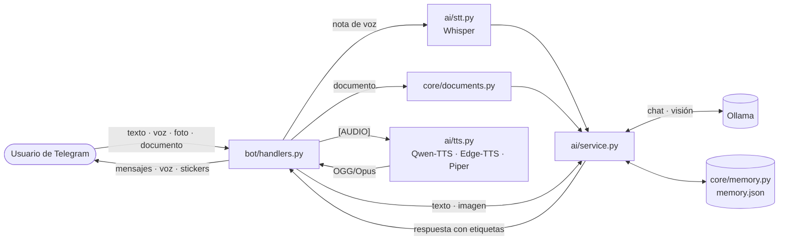

<div align="center">

# 💖 Project MEKA

**Compañera virtual para Telegram con la personalidad de Marin Kitagawa, que funciona con IA local.**

[](https://github.com/Nekimu/PROJECT-MEKA/actions/workflows/ci.yml)
[](https://www.python.org/)
[](https://python-telegram-bot.org/)
[](https://ollama.com)
[](https://github.com/astral-sh/ruff)
[](LICENSE)

[Características](#-características) ·
[Instalación](#️-instalación) ·
[Configuración](#️-configuración) ·
[Uso](#-uso) ·
[Arquitectura](#️-arquitectura) ·
[Solución de problemas](#-solución-de-problemas)

</div>

---

Bot de Telegram que simula una compañera virtual con la personalidad de **Marin Kitagawa** (*Sono Bisque Doll wa Koi wo Suru*). Conversa con un **LLM local** a través de [Ollama](https://ollama.com), entiende **notas de voz**, **fotos** y **documentos**, responde con **voz clonada** y **recuerda** lo que le pides. Todo se ejecuta en tu propia máquina: tus conversaciones no se envían a servicios de IA externos.

> [!NOTE]
> Proyecto personal con fines educativos y de entretenimiento. No está afiliado a los autores ni a los titulares de la obra original.

## ✨ Características

| | Funcionalidad | Detalles |
|---|---|---|
| 🧠 | **IA 100 % local** | Respuestas generadas con modelos LLM vía Ollama (por defecto `gemma3:12b`). |
| 🎭 | **Personalidad definida** | *System prompt* de Marin: cariñosa, entusiasta y otaku. Sustituible por un archivo `.txt`/`.md` propio. |
| 🎙️ | **Notas de voz (STT)** | Transcribe tus audios con [Whisper](https://github.com/openai/whisper) y te responde. |
| 🔊 | **Voz clonada (TTS)** | [Qwen3-TTS](https://github.com/QwenLM/Qwen3-TTS) clona una voz de referencia; Edge-TTS como respaldo ligero; Piper opcional. Los audios llegan como **nota de voz nativa** (OGG/Opus). |
| 🖼️ | **Visión** | Analiza y comenta las **fotos** que le envías (modelo multimodal). |
| 📄 | **Documentos** | Lee y comenta **PDF, DOCX, XLSX, TXT, MD y CSV**. |
| 💭 | **Memoria** | Contexto reciente por chat y memoria persistente por usuario: *"recuerda esto: …"*. |
| 🔒 | **Privado** | Lista blanca de usuarios, archivos temporales que se borran al procesarse y secretos fuera del repositorio. |
| 🪶 | **Ligero en RAM** | Descarga los modelos tras cada interacción para funcionar en hardware modesto (configurable). |

## 📋 Requisitos

- **Python 3.11 o superior** (recomendado **3.12**; Qwen-TTS no está probado en 3.13).
- **[Ollama](https://ollama.com/download)** instalado y en ejecución.
- **[FFmpeg](https://ffmpeg.org/download.html)** en el `PATH` (Whisper lo usa para leer las notas de voz y el TTS para convertirlas a OGG/Opus).
- **Token de Telegram** creado con [@BotFather](https://t.me/BotFather).

| Hardware | Mínimo | Recomendado |
|---|---|---|
| RAM | 8 GB (con `gemma3:4b` y `edge-tts`) | 16 GB (`gemma3:12b` + Qwen-TTS en CPU) |
| GPU | No necesaria | ≥ 8 GB de VRAM para respuestas fluidas |
| Disco | ~6 GB | ~15 GB (modelos de Ollama, Whisper y Qwen) |

## 🛠️ Instalación

```bash
# 1. Clonar el repositorio
git clone https://github.com/Nekimu/PROJECT-MEKA.git
cd PROJECT-MEKA

# 2. Crear y activar un entorno virtual
python -m venv venv
source venv/bin/activate        # Windows: .\venv\Scripts\activate

# 3. Instalar dependencias
pip install -r requirements.txt
pip install -r requirements-qwen.txt   # Opcional: solo si usas el motor de voz qwen-tts

# 4. Descargar el modelo de lenguaje
ollama pull gemma3:12b

# 5. Configurar los secretos
cp .env.example .env            # Windows: copy .env.example .env
```

> [!TIP]
> **¿Sin GPU NVIDIA?** En Linux, instala antes PyTorch para CPU y ahorrarás varios GB de librerías CUDA:
> `pip install torch --index-url https://download.pytorch.org/whl/cpu`. Para GPU consulta [pytorch.org](https://pytorch.org/get-started/locally/).

Edita `.env`:

```dotenv
TELEGRAM_TOKEN=123456789:ABCdefGHIjklMNOpqrsTUVwxyz
ALLOWED_USER_IDS=123456789      # Tu ID de Telegram (consíguelo con @userinfobot)
```

> [!IMPORTANT]
> Si dejas `ALLOWED_USER_IDS` vacío, **cualquier persona** que encuentre tu bot podrá hablar con él y consumir los recursos de tu equipo. Los intentos de usuarios no autorizados quedan registrados en la consola con su ID.

### ▶️ Ejecución

```bash
ollama serve      # Si Ollama no está ya en ejecución
python run.py
```

Al arrancar, el bot hace un diagnóstico no bloqueante de Ollama, TTS y STT y queda a la espera de mensajes.

## ⚙️ Configuración

Toda la configuración vive en [`config.yml`](config.yml). Los secretos (token y usuarios autorizados) van en `.env`.

<details>
<summary><b>Referencia de <code>config.yml</code></b></summary>

| Clave | Por defecto | Descripción |
|---|---|---|
| `app.log_level` | `INFO` | Nivel de logs: `DEBUG`, `INFO`, `WARNING`, `ERROR`. |
| `app.log_conversations` | `true` | Muestra la conversación en la consola. |
| `ai.model` | `gemma3:12b` | Modelo de Ollama. Debe ser **multimodal** para analizar fotos. |
| `ai.base_url` | `http://localhost:11434` | Dirección del servidor de Ollama. |
| `ai.temperature` | `0.8` | Creatividad de las respuestas. |
| `ai.keep_alive` | `0` | `0` descarga el modelo tras cada respuesta (ahorra RAM). `"5m"` lo mantiene cargado (más rápido). |
| `ai.history_size` | `20` | Mensajes recientes que recuerda por chat. |
| `ai.system_prompt_file` | `""` | Ruta a un `.txt`/`.md` con otra personalidad. |
| `ai.options` / `ai.vision_options` | — | Parámetros avanzados de Ollama (`num_predict`, `top_p`...). |
| `stt.model_size` | `base` | Modelo de Whisper: `tiny`, `base`, `small`, `medium`, `large`, `turbo`. |
| `stt.unload_after_use` | `true` | Libera Whisper de la RAM tras cada nota de voz. |
| `tts.engine` | `qwen-tts` | Motor de voz: `qwen-tts`, `edge-tts` o `piper`. |
| `tts.fallback_engine` | `edge-tts` | Motor de respaldo si el principal falla. |
| `tts.convert_to_ogg` | `true` | Convierte el audio a OGG/Opus para que llegue como nota de voz. |
| `tts.qwen.ref_audio` / `ref_text` | — | Audio de referencia a clonar y su transcripción exacta. |
| `tts.qwen.device` | `cpu` | `cpu` o `cuda`. |
| `documents.max_chars` | `4000` | Caracteres de cada documento que se envían al modelo. |
| `media.stickers` / `media.gifs` | `[]` | `file_id` de stickers y URLs de GIFs que Marin puede enviar. Envíale un sticker al bot y su `file_id` aparecerá en la consola. |
| `telegram.drop_pending_updates` | `false` | Ignora los mensajes recibidos mientras el bot estaba apagado. |

</details>

### Elegir modelo de lenguaje

| Modelo (Ollama) | Descarga aprox. | Visión | Comentario |
|---|---|---|---|
| `gemma3:4b` | 3,3 GB | ✅ | Para equipos modestos. |
| `gemma3:12b` | 8,1 GB | ✅ | **Por defecto.** Buen equilibrio calidad/recursos. |
| `gemma4:e4b-it-qat` | ~6 GB | ✅ | Generación más reciente; recomendable probarlo (ver [auditoría](docs/AUDITORIA.md#3-nuevas-versiones-y-viabilidad)). |

> La RAM necesaria es algo mayor que la descarga (contexto, imágenes...). Comprueba los tamaños actuales en [ollama.com/library](https://ollama.com/library).

## 💬 Uso

| Acción | Cómo |
|---|---|
| Iniciar | `/start` |
| Chatear | Escríbele cualquier mensaje |
| Pedir audio | *"Mándame un audio contándome tu día"* |
| Nota de voz | Envía un audio: lo transcribe y te responde |
| Imagen | Envía una foto (con pie de foto opcional como pregunta) |
| Documento | Envía un PDF, DOCX, XLSX, TXT, MD o CSV |
| Recordar un dato | *"recuerda esto: mi color favorito es el azul"* |
| Recuperar un dato | *"¿te acuerdas de mi color favorito?"* |
| Ver recuerdos | `/recuerdos` |
| Borrar recuerdos | `/olvidar` |
| Reiniciar la conversación | `/reset` |

### Scripts de diagnóstico

```bash
python -m scripts.verify_ollama            # Conexión con Ollama y prueba de respuesta
python -m scripts.tts_smoke_test "Hola"    # Genera un audio con el motor TTS configurado
python -m scripts.list_edge_voices es-MX   # Voces disponibles de edge-tts
```

## 🏗️ Arquitectura



Un `asyncio.Lock` garantiza que solo un modelo pesado (Whisper, LLM o TTS) ocupe la RAM a la vez, y las operaciones bloqueantes se ejecutan en hilos para que el bot siga respondiendo a Telegram.

```
PROJECT-MEKA/
├── run.py                  # Punto de entrada
├── bot/                    # Telegram: arranque, filtros de acceso y manejadores
├── ai/                     # LLM (service), STT, TTS, prompts y utilidades de texto
├── core/                   # Configuración, logging, memoria y extracción de documentos
├── scripts/                # Herramientas de diagnóstico
├── tests/                  # Tests automatizados (pytest)
├── audio/                  # Audios de referencia para clonar voz
├── docs/                   # Auditoría técnica y capturas
├── config.yml              # Configuración general
├── .env.example            # Plantilla de secretos
└── requirements*.txt       # Dependencias (base, Qwen-TTS y desarrollo)
```

Carpetas generadas en tiempo de ejecución (ignoradas por git): `temp_audio/`, `temp_media/`, `logs/` y `memory.json`.

<!--
## 📸 Capturas

Guarda tus capturas en docs/screenshots/ (chat.png, voz.png, multimodal.png) y elimina este comentario:

| Conversación | Nota de voz | Análisis multimodal |
|:---:|:---:|:---:|
|  |  |  |
-->

## 🔒 Seguridad y privacidad

- El **token** se carga desde `.env`, excluido por `.gitignore`. **Nunca lo subas al repositorio.**
- **`ALLOWED_USER_IDS`** limita quién puede usar el bot.
- El **historial** se separa por chat y los **recuerdos** por usuario: nadie puede leer lo que otro le contó a Marin.
- Las **fotos, documentos y notas de voz** se guardan en carpetas temporales ignoradas por git y se **eliminan tras procesarse**.
- La inferencia ocurre **en local** vía Ollama. Excepción: `edge-tts` sintetiza la voz en los servidores de Microsoft.
- Los errores internos no se muestran al usuario y los logs no incluyen el contenido de los mensajes (salvo `app.log_conversations`).

> [!WARNING]
> **Clonación de voz:** usa como referencia tu propia voz o una para la que tengas permiso. Clonar la voz de actores o actrices reales puede vulnerar derechos de imagen y de propiedad intelectual.

## 🩺 Solución de problemas

<details>
<summary><b>«No se pudo conectar con Ollama»</b></summary>

Ejecuta `ollama serve` (o abre la app de Ollama) y comprueba que `ai.base_url` apunta a él. Diagnóstico: `python -m scripts.verify_ollama`.
</details>

<details>
<summary><b>«Ollama no tiene el modelo»</b></summary>

Descárgalo con `ollama pull <modelo>` usando el mismo nombre que `ai.model`.
</details>

<details>
<summary><b>Las notas de voz no se entienden o el audio llega como archivo</b></summary>

Falta FFmpeg en el `PATH`. Instálalo (`winget install ffmpeg`, `brew install ffmpeg` o `sudo apt install ffmpeg`) y reinicia la terminal.
</details>

<details>
<summary><b>«Dependencias de Qwen-TTS faltantes»</b></summary>

Instala `pip install -r requirements-qwen.txt` o cambia `tts.engine` a `edge-tts`. Mientras tanto, el bot usa el motor de respaldo (`tts.fallback_engine`).
</details>

<details>
<summary><b>El equipo se queda sin memoria</b></summary>

Usa un modelo más pequeño (`gemma3:4b`), `stt.model_size: tiny` y `tts.engine: edge-tts`. Mantén `ai.keep_alive: 0` y los `unload_after_use: true`.
</details>

## 🧪 Desarrollo

```bash
pip install -r requirements-dev.txt
ruff check . && ruff format --check .
pytest
```

Consulta [CONTRIBUTING.md](CONTRIBUTING.md), el [CHANGELOG](CHANGELOG.md) y la [auditoría técnica](docs/AUDITORIA.md), que incluye la hoja de ruta y las alternativas evaluadas.

## 📄 Licencia

Distribuido bajo la licencia [MIT](LICENSE). Las dependencias conservan sus propias licencias; ten en cuenta que **PyMuPDF** es AGPL-3.0 y **python-telegram-bot** es LGPL-3.0.
