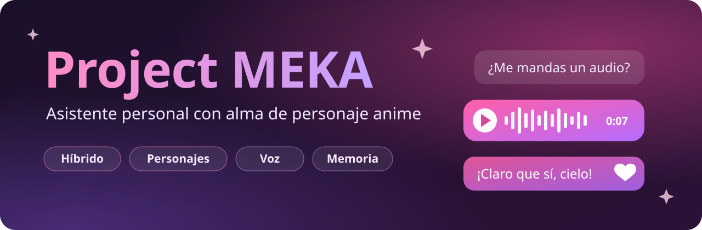

<div align="center">



### Tu compañera virtual con la personalidad de Marin Kitagawa.<br>Conversa, escucha tus audios, ve tus fotos y recuerda lo que le cuentas. Todo en tu equipo.

[](https://github.com/Nekimu/PROJECT-MEKA/actions/workflows/ci.yml)
[](https://www.python.org/)
[](https://python-telegram-bot.org/)
[](https://ollama.com)
[](https://github.com/astral-sh/ruff)
[](LICENSE)
[](https://github.com/Nekimu/PROJECT-MEKA/commits)

[**Inicio rápido**](#-inicio-rápido) ·
[**Características**](#-características) ·
[**Configuración**](#️-configuración) ·
[**Cómo funciona**](#-cómo-funciona) ·
[**Hoja de ruta**](#️-hoja-de-ruta) ·
[**Problemas frecuentes**](#-problemas-frecuentes)

</div>

---

**Project MEKA** es un bot de Telegram que convierte un LLM local en una compañera virtual con personalidad propia: **Marin Kitagawa** (*Sono Bisque Doll wa Koi wo Suru*). Usa [Ollama](https://ollama.com) para pensar, [Whisper](https://github.com/openai/whisper) para escuchar y [Qwen3-TTS](https://github.com/QwenLM/Qwen3-TTS) para hablar con voz clonada. La inferencia se ejecuta en tu propio equipo, así que tus conversaciones no se envían a ningún servicio de IA externo.

> [!TIP]
> **Próximamente, una mascota que vive en tu escritorio.** Prueba el [prototipo](pet/README.md) (abre `pet/web/index.html`) y lee la [visión del proyecto](docs/VISION.md).

> [!NOTE]
> Proyecto personal con fines educativos y de entretenimiento. No está afiliado a los autores ni a los titulares de la obra original.

## 💬 Así es una conversación

<table>
<tr><td>

> **Tú:** recuerda esto: mi cosplay favorito es Shizuku-tan
>
> **Marin:** ¡Anotado, cielo! Me encanta que me cuentes esas cosas 💖
>
> **Tú:** 🎙️ *nota de voz* — «¿te acuerdas de mi cosplay favorito? Cuéntamelo en un audio»
>
> **Marin:** 🔊 *nota de voz* — «¡Claro que sí! Shizuku-tan, ¿cómo iba a olvidarlo?»
>
> **Tú:** 📄 *presupuesto.pdf* — «¿me ayudas a revisarlo?»
>
> **Marin:** ¡A ver, a ver! El total es de 200 € (IVA incluido) y la tela es lo más caro...

</td></tr>
</table>

<sub>Ejemplo ilustrativo. Las respuestas reales dependen del modelo y de la personalidad configurada.</sub>

## ✨ Características

| | Función | Detalle |
|:---:|---|---|
| 🧠 | **IA 100 % local** | Respuestas con cualquier modelo de Ollama (por defecto `gemma3:12b`). |
| 🎭 | **Personalidad propia** | *System prompt* de Marin, sustituible por tu propio archivo `.txt` o `.md`. |
| 🎙️ | **Escucha tus audios** | Transcribe las notas de voz con Whisper y responde como a un mensaje escrito. |
| 🔊 | **Habla con voz clonada** | Qwen3-TTS clona una voz de referencia; Edge-TTS y Piper como alternativas. Llega como nota de voz nativa (OGG/Opus). |
| 🖼️ | **Ve tus fotos** | Comenta las imágenes con un modelo multimodal. |
| 📄 | **Lee documentos** | PDF, DOCX (con tablas), XLSX, TXT, MD y CSV. |
| 💭 | **Recuerda** | Contexto reciente por chat y memoria persistente por usuario con *«recuerda esto: …»*. |
| 🔒 | **Privada** | Lista blanca de usuarios, historial aislado y archivos temporales que se borran al procesarse. |
| 🪶 | **Ligera** | Descarga los modelos tras cada respuesta para funcionar con 16 GB de RAM (configurable). |

## 🚀 Inicio rápido

**Necesitas:** [Python 3.11+](https://www.python.org/downloads/) (recomendado 3.12) · [Ollama](https://ollama.com/download) · [FFmpeg](https://ffmpeg.org/download.html) en el `PATH` · un token de [@BotFather](https://t.me/BotFather).

```bash
git clone https://github.com/Nekimu/PROJECT-MEKA.git
cd PROJECT-MEKA
python -m venv venv
```

<details open>
<summary><b>🐧 Linux / 🍎 macOS</b></summary>

```bash
source venv/bin/activate
pip install -r requirements.txt
cp .env.example .env
```

> [!TIP]
> En Linux sin GPU NVIDIA, instala antes PyTorch para CPU y te ahorrarás varios GB de librerías CUDA:
> `pip install torch --index-url https://download.pytorch.org/whl/cpu`

</details>

<details>
<summary><b>🪟 Windows (PowerShell)</b></summary>

```powershell
.\venv\Scripts\activate
pip install -r requirements.txt
copy .env.example .env
winget install ffmpeg   # si aún no tienes FFmpeg
```

</details>

Después:

```bash
ollama pull gemma3:12b                  # 1. Descarga el modelo
pip install -r requirements-qwen.txt    # 2. Opcional: voz clonada con Qwen3-TTS
python run.py                           # 3. ¡A charlar!
```

Antes de arrancar, edita `.env` con tu token y tu ID de Telegram (puedes obtenerlo con [@userinfobot](https://t.me/userinfobot)):

```dotenv
TELEGRAM_TOKEN=123456789:ABCdefGHIjklMNOpqrsTUVwxyz
ALLOWED_USER_IDS=123456789
```

> [!IMPORTANT]
> Sin `ALLOWED_USER_IDS`, **cualquiera** que encuentre tu bot podrá usarlo y consumir los recursos de tu equipo. Los intentos de usuarios no autorizados aparecen en la consola con su ID.

<details>
<summary><b>💻 ¿Qué equipo necesito?</b></summary>

| | Mínimo | Recomendado |
|---|---|---|
| **RAM** | 8 GB (`gemma3:4b` + `edge-tts`) | 16 GB (`gemma3:12b` + Qwen3-TTS en CPU) |
| **GPU** | No necesaria | ≥ 8 GB de VRAM para respuestas fluidas |
| **Disco** | ~6 GB | ~15 GB (modelos de Ollama, Whisper y Qwen) |

</details>

## 🎮 Uso

| Quieres... | Haz esto |
|---|---|
| Empezar | `/start` |
| Charlar | Escríbele cualquier cosa |
| Que te hable | *«Mándame un audio contándome tu día»* |
| Hablarle | Envía una nota de voz |
| Enseñarle algo | Envía una foto; el pie de foto sirve de pregunta |
| Que lea un archivo | Envía un PDF, DOCX, XLSX, TXT, MD o CSV |
| Que recuerde algo | *«recuerda esto: mi color favorito es el azul»* |
| Preguntarle | *«¿te acuerdas de mi color favorito?»* |
| Ver sus recuerdos | `/recuerdos` |
| Borrar tus recuerdos | `/olvidar` |
| Empezar de cero | `/reset` (olvida la conversación, no los recuerdos) |

## ⚙️ Configuración

Los secretos van en `.env` y todo lo demás en [`config.yml`](config.yml).

<details>
<summary><b>Referencia completa de <code>config.yml</code></b></summary>

| Clave | Por defecto | Descripción |
|---|---|---|
| `app.log_level` | `INFO` | `DEBUG`, `INFO`, `WARNING` o `ERROR`. |
| `app.log_conversations` | `true` | Muestra la conversación en la consola. |
| `ai.model` | `gemma3:12b` | Modelo de Ollama. Debe ser **multimodal** para ver fotos. |
| `ai.base_url` | `http://localhost:11434` | Dirección del servidor de Ollama. |
| `ai.temperature` | `0.8` | Creatividad de las respuestas. |
| `ai.keep_alive` | `0` | `0` descarga el modelo tras responder (ahorra RAM); `"5m"` lo mantiene cargado (más rápido). |
| `ai.history_size` | `20` | Mensajes recientes que recuerda por chat. |
| `ai.system_prompt_file` | `""` | `.txt`/`.md` con otra personalidad. |
| `ai.options` / `ai.vision_options` | — | Parámetros avanzados de Ollama (`num_predict`, `top_p`...). |
| `stt.model_size` | `base` | Whisper: `tiny`, `base`, `small`, `medium`, `large`, `turbo`. |
| `stt.unload_after_use` | `true` | Libera Whisper de la RAM tras cada nota de voz. |
| `tts.engine` | `qwen-tts` | `qwen-tts`, `edge-tts` o `piper`. |
| `tts.fallback_engine` | `edge-tts` | Motor de respaldo si falla el principal. |
| `tts.convert_to_ogg` | `true` | Convierte a OGG/Opus para que llegue como nota de voz. |
| `tts.qwen.ref_audio` / `ref_text` | — | Audio de referencia a clonar y su transcripción exacta. |
| `tts.qwen.device` | `cpu` | `cpu` o `cuda`. |
| `documents.max_chars` | `4000` | Caracteres de cada documento que se envían al modelo. |
| `media.stickers` / `media.gifs` | `[]` | Stickers (`file_id`) y GIFs que Marin puede enviar. Envíale un sticker y su `file_id` aparecerá en la consola. |
| `telegram.drop_pending_updates` | `false` | Ignora los mensajes recibidos con el bot apagado. |

</details>

<details>
<summary><b>¿Qué modelo de lenguaje elijo?</b></summary>

| Modelo | Descarga aprox. | Visión | Para quién |
|---|---|:---:|---|
| `gemma3:4b` | 3,3 GB | ✅ | Equipos modestos |
| `gemma3:12b` | 8,1 GB | ✅ | **Por defecto.** Buen equilibrio entre calidad y recursos |
| `gemma4:e4b-it-qat` | ~6 GB | ✅ | La generación más reciente de Gemma; [merece la pena probarla](docs/AUDITORIA.md#3-nuevas-versiones-y-viabilidad) |

La RAM necesaria es algo mayor que el tamaño de descarga. Consulta los tamaños actuales en [ollama.com/library](https://ollama.com/library).

</details>

## 🧠 Cómo funciona


- **Un modelo pesado a la vez.** Un `asyncio.Lock` impide que Whisper, el LLM y el TTS coincidan en memoria.
- **Sin bloqueos.** La inferencia corre en hilos aparte, así que el bot sigue atendiendo a Telegram mientras piensa.
- **Etiquetas de intención.** El modelo marca sus respuestas con `[AUDIO]`, `[STICKER]` o `[GIF]` y el bot decide cómo entregarlas.

<details>
<summary><b>🧰 Stack tecnológico</b></summary>

| Capa | Tecnología |
|---|---|
| Mensajería | [python-telegram-bot](https://python-telegram-bot.org/) 22 |
| LLM y visión | [Ollama](https://ollama.com) + Gemma 3 |
| Voz → texto | [openai-whisper](https://github.com/openai/whisper) |
| Texto → voz | [Qwen3-TTS](https://github.com/QwenLM/Qwen3-TTS) · [edge-tts](https://github.com/rany2/edge-tts) · [Piper](https://github.com/OHF-Voice/piper1-gpl) |
| Documentos | [PyMuPDF](https://pymupdf.readthedocs.io/) · [python-docx](https://python-docx.readthedocs.io/) · [openpyxl](https://openpyxl.readthedocs.io/) |
| Calidad | [pytest](https://pytest.org) · [Ruff](https://docs.astral.sh/ruff/) · GitHub Actions · Dependabot |

</details>

<details>
<summary><b>🗂️ Estructura del proyecto</b></summary>

```
PROJECT-MEKA/
├── run.py                  # Punto de entrada
├── bot/                    # Telegram: arranque, filtros de acceso y manejadores
├── ai/                     # LLM, STT, TTS, prompts y utilidades de texto
├── core/                   # Configuración, logging, memoria y documentos
├── pet/                    # Mascota de escritorio (web + Tauri), prototipo
├── scripts/                # Herramientas de diagnóstico
├── tests/                  # Tests automatizados (pytest)
├── audio/                  # Audios de referencia para clonar voz
├── docs/                   # Visión, auditoría técnica, imágenes y capturas
├── config.yml              # Configuración general
├── .env.example            # Plantilla de secretos
└── requirements*.txt       # Dependencias: base, Qwen3-TTS y desarrollo
```

Se generan al ejecutar (ignorados por git): `temp_audio/`, `temp_media/`, `logs/` y `memory.json`.

</details>

## 🔒 Privacidad y seguridad

- 🔑 El **token** vive en `.env`, excluido de git. Nunca lo subas al repositorio.
- 👤 **`ALLOWED_USER_IDS`** decide quién puede hablar con el bot.
- 🧱 El **historial** se separa por chat y los **recuerdos** por usuario: nadie puede leer lo que otra persona le contó a Marin.
- 🗑️ Las **fotos, documentos y notas de voz** se borran justo después de procesarse.
- 🏠 La inferencia es **local**. La única excepción es `edge-tts`, que sintetiza la voz en los servidores de Microsoft.
- 🤐 Los errores internos no se muestran al usuario y los logs no incluyen el contenido de los mensajes (salvo con `app.log_conversations`).

> [!WARNING]
> **Clonación de voz:** usa como referencia tu propia voz o una para la que tengas permiso. Clonar la voz de actores o actrices reales puede vulnerar sus derechos.

## 🩺 Problemas frecuentes

<details>
<summary><b>«No se pudo conectar con Ollama»</b></summary>

Ejecuta `ollama serve` (o abre la app de Ollama) y comprueba que `ai.base_url` apunta a él. Para diagnosticarlo: `python -m scripts.verify_ollama`.
</details>

<details>
<summary><b>«Ollama no tiene el modelo»</b></summary>

Descárgalo con `ollama pull <modelo>`, usando el mismo nombre que en `ai.model`.
</details>

<details>
<summary><b>No entiende mis notas de voz o sus audios llegan como archivo</b></summary>

Falta FFmpeg en el `PATH`. Instálalo (`winget install ffmpeg`, `brew install ffmpeg` o `sudo apt install ffmpeg`) y reinicia la terminal.
</details>

<details>
<summary><b>«Dependencias de Qwen-TTS faltantes»</b></summary>

Instálalas con `pip install -r requirements-qwen.txt` o cambia `tts.engine` a `edge-tts`. Mientras tanto, el bot usa el motor de respaldo (`tts.fallback_engine`).
</details>

<details>
<summary><b>Mi equipo se queda sin memoria</b></summary>

Usa un modelo más pequeño (`gemma3:4b`), `stt.model_size: tiny` y `tts.engine: edge-tts`. Mantén `ai.keep_alive: 0` y las opciones `unload_after_use: true`.
</details>

<details>
<summary><b>Herramientas de diagnóstico</b></summary>

```bash
python -m scripts.verify_ollama            # Conexión con Ollama y prueba de respuesta
python -m scripts.tts_smoke_test "Hola"    # Genera un audio con el motor de voz configurado
python -m scripts.list_edge_voices es-MX   # Voces disponibles en edge-tts
```

</details>

## 🗺️ Hoja de ruta

- [x] IA local con Ollama, voz (STT/TTS), visión y documentos
- [x] Memoria persistente por usuario y control de acceso
- [x] Tests automatizados, CI y auditoría técnica ([v1.1.0](CHANGELOG.md))
- [x] Prototipo de **mascota de escritorio** tipo Tamagotchi ([`pet/`](pet/README.md))
- [ ] MEKA Core como servicio: API local de eventos y cerebro intercambiable (Claude, Gemini, Ollama)
- [ ] Gestionar carpetas autorizadas desde el móvil, con confirmación y git
- [ ] Tamagotchi completo: logros, disfraces y rutinas
- [ ] App móvil: Android con burbuja flotante, iOS con widget
- [ ] Transcripción más rápida con [faster-whisper](https://github.com/SYSTRAN/faster-whisper)
- [ ] Memoria semántica: recordar por significado (SQLite + embeddings)

Hacia dónde va el proyecto está en la [visión](docs/VISION.md), y las alternativas técnicas evaluadas, en la [auditoría](docs/AUDITORIA.md).

## 🧪 Desarrollo

```bash
pip install -r requirements-dev.txt
ruff check . && ruff format --check .
pytest
```

¿Quieres contribuir? Lee [CONTRIBUTING.md](CONTRIBUTING.md) y abre un [issue](https://github.com/Nekimu/PROJECT-MEKA/issues/new/choose). Los cambios de cada versión están en el [CHANGELOG](CHANGELOG.md).

<!--
## 📸 Capturas

Guarda las capturas en docs/screenshots/ (chat.png, voz.png, multimodal.png) y elimina este comentario:

| Conversación | Nota de voz | Análisis multimodal |
|:---:|:---:|:---:|
|  |  |  |
-->

## 📄 Licencia y créditos

Código distribuido bajo la licencia [MIT](LICENSE). Las dependencias conservan sus propias licencias; ten en cuenta que **PyMuPDF** es AGPL-3.0 y **python-telegram-bot** es LGPL-3.0.

Marin Kitagawa y *Sono Bisque Doll wa Koi wo Suru* pertenecen a Shinichi Fukuda y SQUARE ENIX. Gracias a los equipos de [Ollama](https://ollama.com), [Whisper](https://github.com/openai/whisper), [Qwen3-TTS](https://github.com/QwenLM/Qwen3-TTS) y [python-telegram-bot](https://python-telegram-bot.org/).

<div align="center">
<sub>Hecho con 💖 por <a href="https://github.com/Nekimu">Nekimu</a></sub>
</div>
