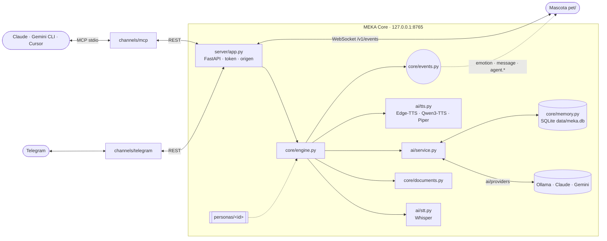

<div align="center">


### Tu asistente personal con alma de personaje anime.<br>Conversa, escucha, ve y recuerda. Cambia de modelo de IA sin cambiar de asistente.

[](https://github.com/Nekimu/PROJECT-MEKA/actions/workflows/ci.yml)
[](https://www.python.org/)
[](https://python-telegram-bot.org/)
[](https://ollama.com)
[](https://github.com/astral-sh/ruff)
[](LICENSE)
[](https://github.com/Nekimu/PROJECT-MEKA/commits)

[**Inicio rápido**](#-inicio-rápido) ·
[**Personajes**](#-personajes) ·
[**Filosofía**](#-filosofía-híbrida) ·
[**Configuración**](#️-configuración) ·
[**Cómo funciona**](#-cómo-funciona) ·
[**Hoja de ruta**](#️-hoja-de-ruta) ·
[**Problemas frecuentes**](#-problemas-frecuentes)

</div>

---

**Project MEKA** es un asistente personal al estilo de Alexa o Google Home, pero con identidad propia: un personaje anime que conversa contigo, escucha tus notas de voz, comenta tus fotos y documentos y recuerda lo que le cuentas. El objetivo final es darle vida a una figura Funko del Meka de D.Va con voz, luces y un avatar en pantalla.

La personalidad, la memoria y la voz pertenecen a MEKA, no al modelo de IA. Piensa con [Ollama](https://ollama.com) en tu equipo, con Claude o con Gemini: cambias de cerebro con una línea de configuración y el personaje sigue siendo el mismo.

> [!TIP]
> **Una mascota que vive en tu escritorio.** Prueba el [prototipo](pet/README.md) (abre `pet/web/index.html`) y lee la [visión del proyecto](docs/VISION.md).

> [!NOTE]
> Proyecto personal con fines educativos y de entretenimiento. No está afiliado a los autores ni a los titulares de la obra original.

## 🎭 Personajes

MEKA tiene un solo "cerebro" técnico y **varios personajes intercambiables**. Cada uno es un paquete en [`personas/`](personas/README.md) con su personalidad, su nombre, su voz y sus frases:

| Personaje | Inspirado en | Estilo |
|---|---|---|
| **MEKA** (`dva`, por defecto) | D.Va / Hanna Song, *Overwatch* | Gamer, segura y competitiva; rigurosa en lo serio |
| **Marin** (`marin`) | Marin Kitagawa, *Sono Bisque Doll wa Koi wo Suru* | Gyaru, otaku del cosplay, cariñosa |
| **Yotsuba** (`yotsuba`) | Yotsuba Nakano, *Go-Tōbun no Hanayome* | Optimista, servicial y deportista |

Para cambiar de personaje basta con `persona: "yotsuba"` en `config.yml` o `MEKA_PERSONA=yotsuba` en `.env`. Crear uno nuevo es copiar una carpeta y editar dos archivos.

## 🧭 Filosofía híbrida

> **Cambiar de motor no debe significar cambiar de asistente.**

- **Identidad propia.** La personalidad, la memoria y la voz viven en el proyecto, no en el proveedor de IA.
- **Híbrido hoy, local como destino.** Se pueden usar servicios en la nube para avanzar, pero lo privado se queda en tu equipo y el objetivo es funcionar en local.
- **Proveedores reemplazables.** Ollama, Gemini, Claude u otros son motores intercambiables, elegidos por tarea, costo y privacidad.
- **Sin voces protegidas.** Los personajes se inspiran en obras existentes pero no imitan grabaciones de sus actrices.

El documento completo, con las iteraciones previstas (Google Home, Home Assistant, adaptadores de proveedor y migración a local), está en [`docs/FILOSOFIA_HIBRIDA.md`](docs/FILOSOFIA_HIBRIDA.md).

## 💬 Así es una conversación

<table>
<tr><td>

> **Tú:** recuerda esto: mi cosplay favorito es Shizuku-tan
>
> **MEKA:** ¡Guardado! Shizuku-tan, buena elección 💾
>
> **Tú:** 🎙️ *nota de voz* — «¿te acuerdas de mi cosplay favorito? Cuéntamelo en un audio»
>
> **MEKA:** 🔊 *nota de voz* — «¡Claro! Shizuku-tan. Eso no se me olvida ni con lag.»
>
> **Tú:** 📄 *presupuesto.pdf* — «¿me ayudas a revisarlo?»
>
> **MEKA:** A ver... El total es de 200 € (IVA incluido) y la tela se lleva la mitad del presupuesto.

</td></tr>
</table>

<sub>Ejemplo ilustrativo con el personaje por defecto (MEKA, inspirado en D.Va). Las respuestas reales dependen del modelo y del personaje.</sub>

## ✨ Características

| | Función | Detalle |
|:---:|---|---|
| 🎭 | **Personajes intercambiables** | D.Va, Marin o Yotsuba, o el tuyo propio: [paquetes en `personas/`](personas/README.md) que se eligen con una línea de configuración. |
| 🧠 | **Cerebro a elegir** | Ollama en local (por defecto `gemma3:12b`), Claude o Gemini, con un cerebro distinto para imágenes, uno de respaldo y un modo `local_only` que no deja salir nada del equipo. |
| 🎙️ | **Escucha tus audios** | Transcribe las notas de voz con Whisper y responde como a un mensaje escrito. |
| 🔊 | **Habla** | Cada personaje tiene su voz (Edge-TTS por defecto; Qwen3-TTS y Piper opcionales). Llega como nota de voz nativa (OGG/Opus). |
| 🖼️ | **Ve tus fotos** | Comenta las imágenes con un modelo multimodal. |
| 📄 | **Lee documentos** | PDF, DOCX (con tablas), XLSX, TXT, MD y CSV. |
| 💭 | **Recuerda** | Recuerdos por usuario (*«recuerda esto: …»*) e historial de cada chat en SQLite. Busca **por significado** con embeddings locales: *«¿qué te conté de mi mascota?»* encuentra *«mi perro se llama Toby»*. |
| 🔒 | **Privada** | Lista blanca de usuarios, historial aislado y archivos temporales que se borran al procesarse. |
| 🪶 | **Ligera** | Descarga los modelos tras cada respuesta para funcionar con 16 GB de RAM (configurable). |
| 🔌 | **Un núcleo, muchos canales** | MEKA Core es un servidor local (REST + WebSocket): Telegram, la mascota de escritorio y los agentes MCP (Claude, Gemini CLI, Cursor) se conectan a él. |

## 🚀 Inicio rápido

**Necesitas:** [Python 3.11+](https://www.python.org/downloads/) (recomendado 3.12) · [Ollama](https://ollama.com/download) · [FFmpeg](https://ffmpeg.org/download.html) en el `PATH` · un token de [@BotFather](https://t.me/BotFather).

```bash
git clone https://github.com/Nekimu/PROJECT-MEKA.git
cd PROJECT-MEKA
python -m venv venv
```

<details open>
<summary><b>🐧 Linux / 🍎 macOS</b></summary>

```bash
source venv/bin/activate
pip install -r requirements.txt
cp .env.example .env
```

> [!TIP]
> En Linux sin GPU NVIDIA, instala antes PyTorch para CPU y te ahorrarás varios GB de librerías CUDA:
> `pip install torch --index-url https://download.pytorch.org/whl/cpu`

</details>

<details>
<summary><b>🪟 Windows (PowerShell)</b></summary>

```powershell
.\venv\Scripts\activate
pip install -r requirements.txt
copy .env.example .env
winget install ffmpeg   # si aún no tienes FFmpeg
```

</details>

Después:

```bash
ollama pull gemma3:12b                  # 1. Descarga el modelo
ollama pull embeddinggemma              #    y el de la memoria semántica (~600 MB)
pip install -r requirements-qwen.txt    # 2. Opcional: Qwen3-TTS (clonar tu propia voz)
pip install -r requirements-cloud.txt   #    Opcional: Claude y Gemini como cerebro
python run.py                           # 3. ¡A charlar! (MEKA Core + Telegram)
```

| Comando | Qué arranca |
|---|---|
| `python run.py` | MEKA Core y los canales activados (Telegram) en un solo proceso |
| `python run.py core` | Solo MEKA Core en `http://127.0.0.1:8765` (API interactiva en `/docs`) |
| `python run.py telegram` | Solo el bot; se conecta a un MEKA Core ya en marcha, incluso en otro equipo |
| `python run.py mcp` | Servidor MCP por stdio para agentes ([ver abajo](#-canales-y-api)) |

Antes de arrancar, edita `.env` con tu token y tu ID de Telegram (puedes obtenerlo con [@userinfobot](https://t.me/userinfobot)):

```dotenv
TELEGRAM_TOKEN=123456789:ABCdefGHIjklMNOpqrsTUVwxyz
ALLOWED_USER_IDS=123456789
```

> [!IMPORTANT]
> Sin `ALLOWED_USER_IDS`, **cualquiera** que encuentre tu bot podrá usarlo y consumir los recursos de tu equipo. Los intentos de usuarios no autorizados aparecen en la consola con su ID.

<details>
<summary><b>💻 ¿Qué equipo necesito?</b></summary>

| | Mínimo | Recomendado |
|---|---|---|
| **RAM** | 8 GB (`gemma3:4b` + `edge-tts`) | 16 GB (`gemma3:12b` + Qwen3-TTS en CPU) |
| **GPU** | No necesaria | ≥ 8 GB de VRAM para respuestas fluidas |
| **Disco** | ~6 GB | ~15 GB (modelos de Ollama, Whisper y Qwen) |

</details>

## 🎮 Uso

| Quieres... | Haz esto |
|---|---|
| Empezar | `/start` |
| Charlar | Escríbele cualquier cosa |
| Que te hable | *«Mándame un audio contándome tu día»* |
| Hablarle | Envía una nota de voz |
| Enseñarle algo | Envía una foto; el pie de foto sirve de pregunta |
| Que lea un archivo | Envía un PDF, DOCX, XLSX, TXT, MD o CSV |
| Que recuerde algo | *«recuerda esto: mi color favorito es el azul»* |
| Preguntarle | *«¿te acuerdas de mi color favorito?»* |
| Ver sus recuerdos | `/recuerdos` |
| Borrar tus recuerdos | `/olvidar` |
| Empezar de cero | `/reset` (olvida la conversación, no los recuerdos) |

## 🔌 Canales y API

Todo pasa por **MEKA Core**, un servidor local que guarda el personaje, la memoria, la IA y la voz. Los canales solo son clientes, así que añadir uno nuevo (Discord, una app móvil, la figura física) no toca el núcleo.

| Canal | Cómo se conecta | Estado |
|---|---|---|
| Telegram | `channels/telegram/` → REST | ✅ |
| Mascota de escritorio | `pet/` → WebSocket `/v1/events` | ✅ |
| Agentes por MCP | `channels/mcp/` → REST (stdio hacia el agente) | ✅ |
| App móvil, figura del Meka | Tailscale + token → REST y WebSocket | Pendiente |

<details>
<summary><b>Conectar MEKA a Claude Desktop, Claude Code, Gemini CLI o Cursor (MCP)</b></summary>

Instala el SDK (`pip install -r requirements-mcp.txt`) y, con MEKA Core en marcha, añade el servidor a la configuración MCP de tu agente:

```json
{
  "mcpServers": {
    "meka": { "command": "python", "args": ["/ruta/a/PROJECT-MEKA/run.py", "mcp"] }
  }
}
```

En Claude Code también vale `claude mcp add meka -- python /ruta/a/PROJECT-MEKA/run.py mcp`. Usa el Python del entorno virtual del proyecto.

| Herramienta | Qué hace |
|---|---|
| `pet_status` | Avisa a la mascota de que el agente empieza (`working`), termina (`done`) o falla (`error`) una tarea |
| `pet_emotion` | Cambia la expresión de la mascota |
| `chat` | Habla con el personaje (conversación propia, separada de Telegram) |
| `remember` · `memories` | Guarda y consulta la memoria del usuario (`memories` acepta un tema y busca por significado) |

</details>

<details>
<summary><b>API REST de MEKA Core</b></summary>

Documentación interactiva en `http://127.0.0.1:8765/docs`. Si defines `MEKA_API_TOKEN`, todas las rutas salvo `/v1/health` piden `Authorization: Bearer <token>` (en el WebSocket, `?token=`).

| Ruta | Uso |
|---|---|
| `GET /v1/health` | Estado y personaje activo |
| `GET /v1/persona` | Nombre, frases y avatar del personaje (sin su prompt) |
| `POST /v1/chat` | Mensaje de texto → respuestas (con audio si llevan `[AUDIO]`) |
| `POST /v1/voice` | Nota de voz → transcripción y respuestas |
| `POST /v1/files` | Imagen o documento → análisis |
| `POST /v1/speech` · `GET /v1/audio/{id}` | Sintetizar un texto y descargar el audio (una sola vez) |
| `POST /v1/sessions/{id}/reset` | Olvidar la conversación reciente |
| `GET` · `POST` · `DELETE /v1/users/{id}/memories` | Ver (`?q=` busca por significado), añadir o borrar recuerdos |
| `POST /v1/events` · `WS /v1/events` | Publicar y recibir eventos de la mascota ([contrato](docs/VISION.md#contrato-de-eventos)) |

```bash
curl -s http://127.0.0.1:8765/v1/chat -H "Content-Type: application/json" \
  -d '{"session": "prueba", "user": "local", "text": "¡Hola!", "audio": false}'
```

</details>

## ⚙️ Configuración

Los secretos van en `.env` y todo lo demás en [`config.yml`](config.yml).

<details>
<summary><b>Referencia completa de <code>config.yml</code></b></summary>

| Clave | Por defecto | Descripción |
|---|---|---|
| `persona` | `dva` | Personaje activo: una carpeta de [`personas/`](personas/README.md). También con `MEKA_PERSONA` en `.env`. |
| `app.log_level` | `INFO` | `DEBUG`, `INFO`, `WARNING` o `ERROR`. |
| `app.log_conversations` | `true` | Muestra la conversación en la consola. |
| `server.host` / `server.port` | `127.0.0.1` / `8765` | Dónde escucha MEKA Core. Fuera de `127.0.0.1` exige `MEKA_API_TOKEN`. |
| `server.url` | `""` | Cómo encuentran los canales al núcleo si está en otro equipo (o `MEKA_CORE_URL`). |
| `server.allowed_origins` | `[]` | Webs extra que pueden conectarse; la mascota y `localhost` ya están permitidas. |
| `server.max_upload_mb` | `20` | Tamaño máximo de las notas de voz, imágenes y documentos. |
| `server.broadcast_messages` | `true` | La mascota también dice lo que MEKA responde por otros canales. |
| `paths.memory_db` / `paths.temp_dir` | `data/meka.db` / `temp` | Base de datos SQLite (recuerdos e historial) y archivos temporales. |
| `memory.remember_pattern` / `recall_triggers` | — | Frases que guardan y recuperan recuerdos. |
| `memory.persist_history` | `true` | El historial de cada chat sobrevive a los reinicios. |
| `memory.semantic.enabled` / `model` | `true` / `embeddinggemma` | Memoria por significado con embeddings de Ollama. Sin el modelo, busca solo por palabras. |
| `memory.semantic.min_similarity` / `auto_recall_similarity` | `0.35` / `0.6` | Similitud mínima al preguntar y para recordar sin que preguntes (`0` lo desactiva). Calíbralos con `python -m scripts.semantic_check`. |
| `ai.provider` | `ollama` | Cerebro de la conversación: `ollama`, `claude` o `gemini`. |
| `ai.vision_provider` / `ai.fallback_provider` | `""` | Cerebro para imágenes y cerebro de respaldo si el principal falla o se niega. |
| `ai.local_only` | `false` | `true` ignora los proveedores en la nube: nada sale del equipo. |
| `ai.history_size` | `20` | Mensajes recientes que recuerda por chat. |
| `ai.providers.ollama.model` | `gemma3:12b` | Modelo de Ollama. Debe ser **multimodal** para ver fotos. |
| `ai.providers.ollama.keep_alive` | `0` | `0` descarga el modelo tras responder (ahorra RAM); `"5m"` lo mantiene cargado (más rápido). |
| `ai.providers.ollama.*` | — | `base_url`, `temperature`, `options` y `vision_options` de Ollama. |
| `ai.providers.claude.model` / `effort` | `claude-opus-5-5` / `low` | Modelo de Claude y cuánto piensa (`low` a `max`). Requiere `ANTHROPIC_API_KEY`. |
| `ai.providers.gemini.model` | `gemini-flash-latest` | Modelo de Gemini. Requiere `GEMINI_API_KEY`. |
| `stt.model_size` | `base` | Whisper: `tiny`, `base`, `small`, `medium`, `large`, `turbo`. |
| `stt.unload_after_use` | `true` | Libera Whisper de la RAM tras cada nota de voz. |
| `tts.engine` | `edge-tts` | `edge-tts`, `qwen-tts` o `piper`. La voz de edge-tts la pone cada personaje. |
| `tts.fallback_engine` | `""` | Motor de respaldo si falla el principal. |
| `tts.convert_to_ogg` | `true` | Convierte a OGG/Opus para que llegue como nota de voz. |
| `tts.qwen.ref_audio` / `ref_text` | — | Solo con Qwen3-TTS: tu propia voz (en `voices/`, ignorada por git) y su transcripción exacta. |
| `tts.qwen.device` | `cpu` | `cpu` o `cuda`. |
| `documents.max_chars` | `4000` | Caracteres de cada documento que se envían al modelo. |
| `telegram.enabled` | `true` | Arranca el bot con `python run.py`. |
| `telegram.typing_delay` | `1.0` | Multiplica las pausas de "escribiendo…"; `0` responde sin pausas. |
| `telegram.stickers` / `telegram.gifs` | `[]` | Stickers (`file_id`) y GIFs que el personaje puede enviar. Envíale un sticker y su `file_id` aparecerá en la consola. |
| `telegram.drop_pending_updates` | `false` | Ignora los mensajes recibidos con el bot apagado. |
| `mcp.session` / `mcp.user` | `mcp` / `""` | Conversación y memoria del canal MCP (vacío = el primer ID de `ALLOWED_USER_IDS`). |

</details>

<details>
<summary><b>¿Qué cerebro elijo?</b></summary>

| Cerebro | Privacidad | Costo | Para qué |
|---|---|---|---|
| **Ollama** (local) | Nada sale del equipo | Gratis; usa tu RAM/GPU | Por defecto. Conversación diaria y todo lo privado |
| **Claude** | El texto va a Anthropic | Por uso (`effort: low` lo abarata) | Respuestas de más calidad, documentos largos, visión |
| **Gemini** | El texto va a Google; en el nivel gratuito puede usarse para mejorar sus productos | Nivel gratuito disponible | Probar sin GPU, o como respaldo |

Ejemplos de `config.yml`:

```yaml
ai:
  provider: "claude"            # Charla con Claude...
  fallback_provider: "ollama"   # ...y si no hay internet o se niega, responde Ollama
```

```yaml
ai:
  provider: "ollama"            # Todo en local...
  vision_provider: "gemini"     # ...salvo las fotos, que analiza Gemini
```

Modelos de Ollama recomendados:

| Modelo | Descarga aprox. | Visión | Para quién |
|---|---|:---:|---|
| `gemma3:4b` | 3,3 GB | ✅ | Equipos modestos |
| `gemma3:12b` | 8,1 GB | ✅ | **Por defecto.** Buen equilibrio entre calidad y recursos |
| `gemma4:e4b-it-qat` | ~6 GB | ✅ | La generación más reciente de Gemma; [merece la pena probarla](docs/AUDITORIA.md#3-nuevas-versiones-y-viabilidad) |

La RAM necesaria es algo mayor que el tamaño de descarga. Consulta los tamaños actuales en [ollama.com/library](https://ollama.com/library).

</details>

## 🧠 Cómo funciona



- **Los canales no cargan modelos.** Telegram y MCP solo hablan con MEKA Core por HTTP; pueden ir en otro equipo.
- **Un modelo pesado a la vez.** Un `asyncio.Lock` en el núcleo impide que Whisper, el LLM y el TTS coincidan en memoria, venga la petición del canal que venga.
- **Sin bloqueos.** La inferencia corre en hilos aparte, así que el servidor sigue atendiendo mientras piensa.
- **Etiquetas de intención.** El modelo marca sus respuestas con `[AUDIO]`, `[STICKER]` o `[GIF]` y el bot decide cómo entregarlas.

<details>
<summary><b>🧰 Stack tecnológico</b></summary>

| Capa | Tecnología |
|---|---|
| Núcleo | [FastAPI](https://fastapi.tiangolo.com/) + [Uvicorn](https://www.uvicorn.org/) (REST y WebSocket) · [httpx](https://www.python-httpx.org/) |
| Canales | [python-telegram-bot](https://python-telegram-bot.org/) 22 · [MCP Python SDK](https://github.com/modelcontextprotocol/python-sdk) 2 |
| LLM y visión | [Ollama](https://ollama.com) + Gemma 3 · [Claude](https://platform.claude.com/docs) ([SDK](https://github.com/anthropics/anthropic-sdk-python)) · [Gemini](https://ai.google.dev/gemini-api/docs) ([google-genai](https://github.com/googleapis/python-genai)) |
| Memoria | SQLite + FTS5 + [sqlite-vec](https://github.com/asg017/sqlite-vec) · embeddings con `embeddinggemma` ([evaluación](docs/MEMORIA.md)) |
| Voz → texto | [openai-whisper](https://github.com/openai/whisper) |
| Texto → voz | [Qwen3-TTS](https://github.com/QwenLM/Qwen3-TTS) · [edge-tts](https://github.com/rany2/edge-tts) · [Piper](https://github.com/OHF-Voice/piper1-gpl) |
| Documentos | [PyMuPDF](https://pymupdf.readthedocs.io/) · [python-docx](https://python-docx.readthedocs.io/) · [openpyxl](https://openpyxl.readthedocs.io/) |
| Calidad | [pytest](https://pytest.org) · [Ruff](https://docs.astral.sh/ruff/) · GitHub Actions · Dependabot |

</details>

<details>
<summary><b>🗂️ Estructura del proyecto</b></summary>

```
PROJECT-MEKA/
├── run.py                  # Punto de entrada: all | core | telegram | mcp
├── server/                 # MEKA Core: API REST + WebSocket (FastAPI)
├── core/                   # Motor, eventos, configuración, memoria, documentos y personajes
├── ai/                     # Proveedores de IA (ai/providers), STT, TTS, prompts y texto
├── channels/               # Clientes del núcleo: Telegram, MCP y el cliente HTTP común
├── personas/               # Paquetes de personaje (D.Va, Marin, Yotsuba...)
├── pet/                    # Mascota de escritorio (web + Tauri), prototipo
├── scripts/                # Herramientas de diagnóstico
├── tests/                  # Tests automatizados (pytest)
├── docs/                   # Filosofía híbrida, visión, auditoría e imágenes
├── config.yml              # Configuración general
├── .env.example            # Plantilla de secretos
└── requirements*.txt       # Dependencias: base, nube, MCP, Qwen3-TTS y desarrollo
```

Se generan al ejecutar o son personales (ignorados por git): `data/` (la base de datos), `temp/`, `logs/`, `models/` y `voices/`.

</details>

## 🔒 Privacidad y seguridad

- 🔑 Los **tokens** viven en `.env`, excluido de git. Nunca los subas al repositorio.
- 🏠 **MEKA Core solo escucha en este equipo** (`127.0.0.1`). Para abrirlo a tu red o a Tailscale hace falta `MEKA_API_TOKEN`; sin él, el servidor se niega a arrancar.
- 🌐 El servidor **rechaza webs ajenas**: una página cualquiera no puede usar tu MEKA desde el navegador. Solo la mascota, `localhost` y los orígenes de `server.allowed_origins`.
- 👤 **`ALLOWED_USER_IDS`** decide quién puede hablar con el bot.
- 🧱 El **historial** se separa por chat y los **recuerdos** por usuario: nadie puede leer lo que otra persona le contó al asistente.
- 🗑️ Las **fotos, documentos y notas de voz** se borran justo después de procesarse.
- 🏠 Con Ollama la inferencia es **local**. Si eliges Claude o Gemini, el texto (y las fotos) de la conversación va a su API; `ai.local_only: true` lo impide. `edge-tts` sintetiza la voz en los servidores de Microsoft.
- 🤐 Los errores internos no se muestran al usuario y los logs no incluyen el contenido de los mensajes (salvo con `app.log_conversations`).

> [!WARNING]
> **Clonación de voz:** usa como referencia tu propia voz o una para la que tengas permiso. Clonar la voz de actores o actrices reales puede vulnerar sus derechos.

## 🩺 Problemas frecuentes

<details>
<summary><b>«No se pudo conectar con Ollama»</b></summary>

Ejecuta `ollama serve` (o abre la app de Ollama) y comprueba que `ai.providers.ollama.base_url` apunta a él. Para diagnosticarlo: `python -m scripts.verify_ollama`.
</details>

<details>
<summary><b>«Ollama no tiene el modelo»</b></summary>

Descárgalo con `ollama pull <modelo>`, usando el mismo nombre que en `ai.providers.ollama.model`.
</details>

<details>
<summary><b>No entiende mis notas de voz o sus audios llegan como archivo</b></summary>

Falta FFmpeg en el `PATH`. Instálalo (`winget install ffmpeg`, `brew install ffmpeg` o `sudo apt install ffmpeg`) y reinicia la terminal.
</details>

<details>
<summary><b>«Dependencias de Qwen-TTS faltantes»</b></summary>

Instálalas con `pip install -r requirements-qwen.txt` o cambia `tts.engine` a `edge-tts`. Mientras tanto, el bot usa el motor de respaldo (`tts.fallback_engine`).
</details>

<details>
<summary><b>Mi equipo se queda sin memoria</b></summary>

Usa un modelo más pequeño (`gemma3:4b`), `stt.model_size: tiny` y `tts.engine: edge-tts`. Mantén `ai.providers.ollama.keep_alive: 0` y las opciones `unload_after_use: true`.
</details>

<details>
<summary><b>«MEKA Core no responde en http://127.0.0.1:8765»</b></summary>

El canal no encuentra el núcleo. Arráncalo con `python run.py core` (o usa `python run.py`, que lanza los dos). Si está en otro equipo, pon su dirección en `server.url` o en `MEKA_CORE_URL`, y el mismo `MEKA_API_TOKEN` en ambos.
</details>

<details>
<summary><b>Herramientas de diagnóstico</b></summary>

```bash
python -m scripts.verify_ollama            # Conexión con Ollama y prueba de respuesta
python -m scripts.tts_smoke_test "Hola"    # Genera un audio con el motor de voz configurado
python -m scripts.list_edge_voices es-MX   # Voces disponibles en edge-tts
python -m scripts.semantic_check "¿qué te conté de mi mascota?"   # Similitudes de la memoria semántica
```

</details>

## 🗺️ Hoja de ruta

- [x] IA local con Ollama, voz (STT/TTS), visión y documentos
- [x] Memoria persistente por usuario y control de acceso
- [x] Tests automatizados, CI y auditoría técnica ([v1.1.0](CHANGELOG.md))
- [x] Prototipo de **mascota de escritorio** tipo Tamagotchi ([`pet/`](pet/README.md))
- [x] **Personajes intercambiables** independientes del modelo de IA ([`personas/`](personas/README.md))
- [x] **Cerebro intercambiable**: Ollama, Claude y Gemini, con enrutamiento por tarea, respaldo y modo `local_only`
- [x] **Memoria en SQLite** con búsqueda de texto completo e historial persistente ([evaluación](docs/MEMORIA.md))
- [x] **Memoria semántica**: recordar por significado con embeddings locales y `sqlite-vec`
- [x] **MEKA Core como servicio**: servidor local REST + WebSocket con Telegram, MCP y la mascota como clientes
- [ ] Probar la personalidad con Gemini para Home y con Home Assistant (iteraciones 0 y 1)
- [ ] Base del Funko del Meka (ESP32-S3, luces, sensor táctil) y caja de holograma ([planos](https://claude.ai/artifact/TVgmmCCLpmyd2KxQCpEEki))
- [ ] Google Drive como memoria documental compartida con otros agentes
- [ ] Gestionar carpetas autorizadas desde el móvil, con confirmación y git
- [ ] Tamagotchi completo: logros, disfraces y rutinas
- [ ] App móvil: Android con burbuja flotante, iOS con widget
- [ ] Transcripción más rápida con [faster-whisper](https://github.com/SYSTRAN/faster-whisper)

La dirección del proyecto está en la [filosofía híbrida](docs/FILOSOFIA_HIBRIDA.md) y la [visión](docs/VISION.md); las alternativas técnicas evaluadas, en la [auditoría](docs/AUDITORIA.md).

## 🧪 Desarrollo

```bash
pip install -r requirements-dev.txt
ruff check . && ruff format --check .
pytest
```

¿Quieres contribuir? Lee [CONTRIBUTING.md](CONTRIBUTING.md) y abre un [issue](https://github.com/Nekimu/PROJECT-MEKA/issues/new/choose). Los cambios de cada versión están en el [CHANGELOG](CHANGELOG.md).

<!--
## 📸 Capturas

Guarda las capturas en docs/screenshots/ (chat.png, voz.png, multimodal.png) y elimina este comentario:

| Conversación | Nota de voz | Análisis multimodal |
|:---:|:---:|:---:|
|  |  |  |
-->

## 📄 Licencia y créditos

Código distribuido bajo la licencia [MIT](LICENSE). Las dependencias conservan sus propias licencias; ten en cuenta que **PyMuPDF** es AGPL-3.0 y **python-telegram-bot** es LGPL-3.0.

Los personajes son interpretaciones originales inspiradas en obras de terceros: D.Va y *Overwatch* pertenecen a Blizzard Entertainment; Marin Kitagawa y *Sono Bisque Doll wa Koi wo Suru*, a Shinichi Fukuda y SQUARE ENIX; Yotsuba Nakano y *Go-Tōbun no Hanayome*, a Negi Haruba y Kodansha. Gracias a los equipos de [Ollama](https://ollama.com), [Whisper](https://github.com/openai/whisper), [Qwen3-TTS](https://github.com/QwenLM/Qwen3-TTS) y [python-telegram-bot](https://python-telegram-bot.org/).

<div align="center">
<sub>Hecho con 💖 por <a href="https://github.com/Nekimu">Nekimu</a></sub>
</div>
