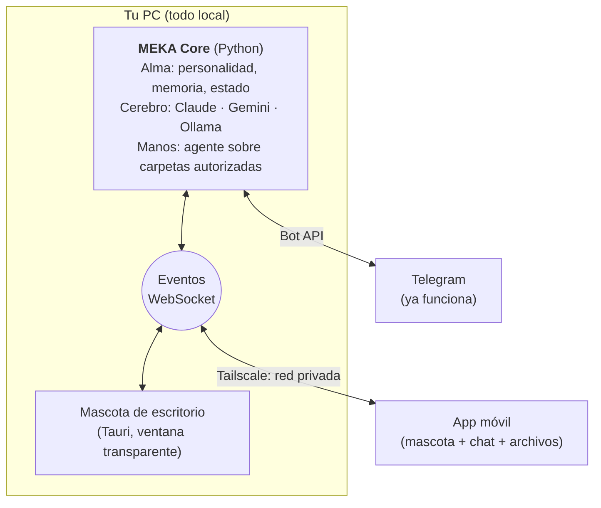

# Visión de MEKA

> **Una compañera que vive en tu escritorio y en tu móvil, con el estilo de tus animes y videojuegos favoritos, que te acompaña mientras trabajas y te ayuda a gestionar tus proyectos sin que tus archivos salgan de tu equipo.**

Este documento describe hacia dónde va el proyecto; la estrategia de proveedores (nube, local, agentes externos) está en la [filosofía híbrida](FILOSOFIA_HIBRIDA.md). El análisis técnico, las versiones y las alternativas evaluadas están en la [auditoría](AUDITORIA.md). El prototipo de la mascota está en [`pet/`](../pet/README.md).

## Por qué MEKA

Ya existen asistentes que trabajan con tus archivos locales, pero son herramientas, no compañeros:

| | Gemini Spark | Claude Code Remote Control | **MEKA** |
|---|---|---|---|
| Archivos locales | Carpetas que enlazas | Carpeta de un proyecto | Carpetas que autorizas |
| Desde el móvil | Anunciado | Sí | Sí (Telegram hoy; app después) |
| Plataforma | Solo macOS (beta, Google AI Ultra, EE. UU.) | Windows, macOS, Linux | Windows, macOS, Linux |
| Interfaz | Asistente genérico | Terminal de programación | **Una mascota animada con personalidad y memoria** |
| Cerebro | Gemini | Claude | **El que elijas**: Claude, Gemini u Ollama local |

Lo que diferencia a MEKA no es gestionar archivos, sino **la relación**: te recuerda, reacciona a lo que pasa, tiene días buenos y malos, y lleva el aspecto de los personajes que te gustan.

## Principios

1. **Local primero.** Tus archivos, tu memoria y tu mascota viven en tu equipo. Solo sale el texto que envías al cerebro que elijas, y con Ollama ni eso.
2. **Viva, pero no punitiva.** Como un Tamagotchi moderno: tiene necesidades y estados de ánimo, pero nunca muere ni te regaña por no abrirla.
3. **Personalidad antes que funciones.** Cada respuesta, animación y frase tiene que sonar al personaje.
4. **Cerebro intercambiable.** La lógica no depende de un proveedor de IA, y el personaje tampoco: es un paquete en [`personas/`](../personas/README.md) que se elige por configuración.
5. **Segura por diseño.** Solo toca lo que autorizas, pide permiso antes de cambiar nada y todo se puede deshacer.
6. **Arte original en el repositorio público.** El *fan art* de personajes con derechos (D.Va, Nino Nakano, Steve, Master Chief, Marin...) es para uso personal y se guarda fuera del repositorio.

## Arquitectura

| Pieza | Responsabilidad | Estado |
|---|---|---|
| **Alma** | Personalidad, memoria por usuario, estado de la mascota | ✅ Personalidad y memoria (v1.1) |
| **Cerebro** | Generar respuestas e interpretar imágenes y documentos | ✅ Ollama · ⏳ adaptador para Claude y Gemini |
| **Manos** | Leer y organizar archivos en carpetas autorizadas | ⏳ Fase 3 |
| **Cuerpo** | Mostrar a la mascota y recoger la interacción | ✅ Telegram · ✅ prototipo de escritorio |

## Contrato de eventos

MEKA Core y sus clientes (mascota, app móvil) se comunican con mensajes JSON `{"type": ..., "data": {...}}` por WebSocket en `ws://127.0.0.1:8765/events`. La conexión solo escucha en local; el acceso remoto irá por Tailscale y con token. El prototipo de la mascota **ya implementa este contrato** (`pet/web/pet.js`).

### De MEKA Core a los clientes

| `type` | `data` | La mascota... |
|---|---|---|
| `agent.working` | `{"task": "Ordenar Descargas"}` | Se pone a trabajar (animación continua) |
| `agent.done` | `{"summary": "Ordené 42 archivos"}` | Celebra; sube el ánimo y el afecto |
| `agent.error` | `{"message": "No pude abrir..."}` | Se agobia; baja un poco el ánimo |
| `agent.confirm` | `{"action": "borrar 3 duplicados"}` | Pide permiso (se confirma desde el móvil o la mascota) |
| `message` | `{"text": "...", "emotion": "happy"}` | Dice el texto con la emoción indicada |
| `emotion` | `{"emotion": "thinking"}` | Cambia de expresión |
| `budget.low` | `{}` | Se pone triste: se acaban los créditos de la API |

Emociones válidas: `idle`, `happy`, `working`, `thinking`, `sleeping`, `eating`, `error`, `celebrate`, `sad`.

### De los clientes a MEKA Core

| `type` | `data` | Uso |
|---|---|---|
| `client.hello` | `{"client": "pet", "skin": "meka"}` | Presentarse al conectar |
| `user.message` | `{"text": "..."}` | Lo que escribes en la mascota |
| `user.confirm` *(próximamente)* | `{"id": "...", "approved": true}` | Responder a `agent.confirm` |

## Personajes

| Personaje | Origen | Poses | Uso |
|---|---|---|---|
| **MEKA** (nombre provisional) | Original: chica de visor y horquilla de estrella | 3 (guiño, abrazo, combate contra un *bug*) | Mascota principal |
| **Nekimu** | Tu avatar | 10 (comer, dormir, `SQL ERROR`, *payday*...) | Personaje "modo desarrollador" |
| **Espadachina** | Original | 1 | Desbloqueable (afecto 50) |
| **Kitsune** | Original | 1 | Desbloqueable (afecto 70) |

### Guía de arte para los personajes

Cada personaje necesita como mínimo `idle`. Lo ideal es una imagen por estado:

| Estado | Qué expresa | Idea de pose |
|---|---|---|
| `idle` | Reposo | Sonrisa, guiño, mirando al usuario |
| `happy` | La acaricias o juegas | Ojos cerrados de felicidad, abrazando algo |
| `working` | El agente trabaja | Concentrada, tecleando o luchando contra un *bug* |
| `thinking` | Pensando o analizando | Mano en la barbilla, holograma, lupa |
| `sleeping` | Duerme | Ojos cerrados, almohada o taza, "Zzz" |
| `eating` | La alimentas | Comiendo su comida favorita |
| `error` | Algo falló | Pánico, sudor, pantalla roja |
| `celebrate` | Tarea completada | Saltando, confeti, signo de victoria |
| `sad` | Sola o sin recursos | Cabizbaja, lágrima, cartera vacía |

**Para que el set sea coherente al generarlo con Gemini u otra IA:**
- Usa siempre la misma imagen del personaje como referencia y repite su descripción física exacta.
- Mismo estilo: sticker con **contorno blanco grueso** sobre **fondo liso** de un solo color (el recorte automático se basa en eso).
- Mismo encuadre (por ejemplo, medio cuerpo y centrado) y una sola emoción por imagen.
- Después: `python pet/tools/stickerize.py imagen.jpg pet/web/skins/<personaje>/<estado>.webp`.

### Estilos visuales

| Estilo | Estado | Comentario |
|---|---|---|
| **Stickers anime** | ✅ Prototipo | Expresivos y baratos de producir; se animan con movimientos y partículas |
| **Pixel art** | 🔍 Vista previa automática en el menú | Para el definitivo: sprites dibujados a mano con varios fotogramas por estado |
| **Rive** | Idea | Animación vectorial con máquina de estados incorporada (parpadeo, respiración) |
| **Live2D** | Idea | Lo más "anime", pero caro de producir y pesado |

## Mecánicas de Tamagotchi

| Estadística | Baja por hora | Se recupera con | Si está baja |
|---|---|---|---|
| ⚡ Energía | −4 despierta (+15 dormida) | Dormir | Se queja y duerme sola por debajo de 12 |
| 🍙 Saciedad | −6 | Alimentar (+30) | Pide comida; el ánimo baja el doble |
| 😊 Ánimo | −3 | Caricias, juegos, tareas completadas | Se pone triste |
| 💙 Afecto | −0,5 | Caricias, juegos, tareas completadas | Desbloquea personajes al subir |

**Reglas:**
- Ninguna estadística baja de 5: no hay muerte ni castigo.
- El tiempo avanza con la app cerrada, con un máximo de 48 h.
- Duerme sola de madrugada si no le haces caso durante 10 minutos.
- Un desbloqueo es para siempre.

**Ideas para más adelante:**
- Disfraces y cosplays como logros ligados a tu trabajo real, por ejemplo "10 tareas completadas".
- Rachas diarias.
- Rutinas según la hora: café por la mañana, sueño por la noche.
- Frases que cambian según el ánimo.

## Plataformas

| Plataforma | Cómo | Estado |
|---|---|---|
| Escritorio | Tauri 2: ventana transparente, sin bordes y siempre visible | ✅ Prototipo |
| Telegram | Bot actual | ✅ |
| Android | App con burbuja flotante sobre otras apps | Fase 5 |
| iOS | Widget y Live Activity (iOS no permite superposiciones sobre otras apps) | Fase 5 |

## Seguridad de las "manos"

- **Carpetas autorizadas** por ti y revocables. Fuera de ellas, nada.
- **Solo lectura por defecto.** Antes de escribir crea un **punto de restauración en git** y pide confirmación (`agent.confirm`).
- **Sin terminal** al principio.
- **API local con token**, accesible desde fuera solo por Tailscale (red privada).
- **Registro** de todo lo que hace.

## Hoja de ruta

| Fase | Entregable | Estado |
|---|---|---|
| 0 | Bot de Telegram estable, seguro y con tests | ✅ v1.1 |
| 1 | **MEKA Core como servicio**: WebSocket con este contrato y adaptador de cerebro (Claude, Gemini, Ollama) | ⏳ Siguiente |
| 2 | **Mascota de escritorio** | ✅ Prototipo (`pet/`) |
| 3 | Manos: carpetas autorizadas, lectura y luego escritura con git y confirmación | Pendiente |
| 4 | Tamagotchi completo: logros, disfraces, rutinas | Pendiente |
| 5 | Móvil: Android con burbuja e iOS con widget, vía Tailscale | Pendiente |

## Decisiones abiertas

- **Nombre definitivo** de la mascota principal ("MEKA" es provisional).
- **Estilo final:** stickers anime, pixel art dibujado a mano o Rive.
- **Cerebro por defecto:** Claude Haiku (≈ 1 $/mes), Gemini Flash gratis (con sus condiciones de privacidad) u Ollama local.
- **Voz:** sustituir los audios de referencia actuales por una voz original.
